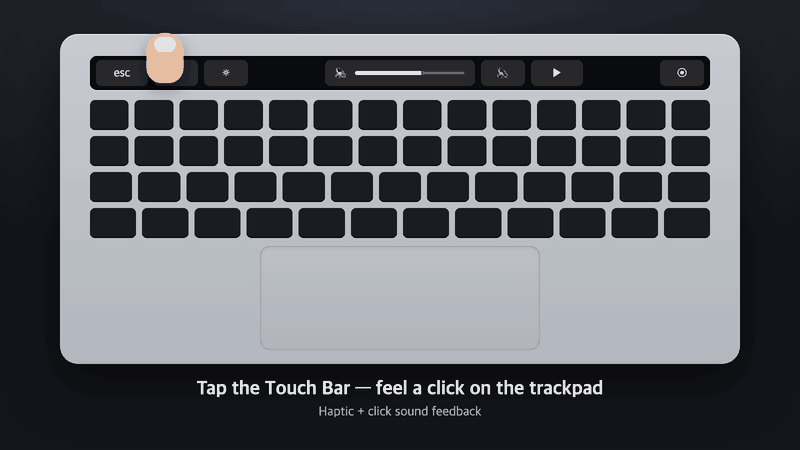
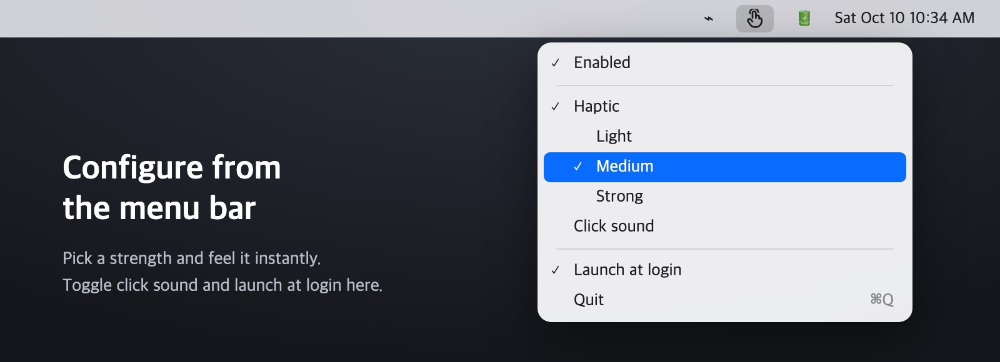

# TouchBarFeedback

[한국어](README.md) | **English**

<p align="center"></p>

A tiny macOS menu bar app that gives you **haptic feedback on the trackpad** and/or a **click sound** whenever you touch the MacBook Touch Bar.

The Touch Bar has no haptic motor, so taps feel flat. This app detects Touch Bar touches and fires the Force Touch trackpad's haptic engine right below it — with your hands on the keyboard, you feel a subtle "tap" under your palm.

## Features

- Feedback on every Touch Bar touch — Esc, volume slider, app buttons, anything
- Three haptic strengths: Light / Medium / Strong
- Optional click sound (system "Tink")
- Launch at login
- Settings saved automatically; lives in the menu bar, no windows

## Requirements

- MacBook Pro with a Touch Bar
- macOS 13 Ventura or later (tested on macOS 15.5, Apple Silicon)
- Xcode or Command Line Tools (`xcode-select --install`)

## Install

```bash
git clone https://github.com/suinegyzal/TouchBarFeedback.git
cd TouchBarFeedback
./build.sh
open ~/Applications/TouchBarFeedback.app
```

`build.sh` compiles the source and installs `~/Applications/TouchBarFeedback.app`.

### First launch

1. Grant **Input Monitoring** permission:
   System Settings → Privacy & Security → Input Monitoring → turn on TouchBarFeedback
   (the "⚠️ Input Monitoring permission needed" menu item opens that pane for you)
2. **Quit and relaunch the app.** The permission only takes effect after a relaunch.
   (If a "Quit & Reopen" prompt appears, just click it.)
3. Tap the Touch Bar.

> **If you rebuild**, the ad-hoc signature changes and the old permission no longer applies. Remove TouchBarFeedback from the Input Monitoring list with **−**, add it again, and relaunch the app. Even if the switch looks on, the old entry won't work — remove and re-add it.

## Usage

Click the 👆 icon in the menu bar. The menu follows your system language (Korean or English).

<p align="center"></p>

| Menu item | What it does |
|---|---|
| Enabled | Turn all feedback on/off |
| Haptic / strength | Trackpad haptic and its strength (choosing one previews it) |
| Click sound | Play a click sound on each tap |
| Launch at login | Start automatically after reboot |

## How it works

1. **Touch detection**: a listen-only `CGEventTap` receives gesture events and tells Touch Bar touches apart from trackpad touches by the source device type (`NSTouch.device.deviceType == 3`). Events from other apps are never blocked or modified.
2. **Haptics**: to vibrate even when no finger is on the trackpad, it drives the trackpad actuator directly via the private `MultitouchSupport` framework (`MTActuator*` functions).
3. **Sound**: a preloaded system sound is played for minimal latency.

## Known limitations

- Haptics rely on a **private Apple API**, so they may break after a macOS update. This also means the app can't ship on the App Store.
- You feel the vibration on the trackpad, not on the Touch Bar itself.

## Troubleshooting

- **No feedback?** Remove and re-add the Input Monitoring permission as described above, then relaunch the app. This fixes most cases.
- **Debug log**: run the command below and relaunch the app; permission state and touch events are written to `~/Library/Logs/TouchBarFeedback.log`.
  ```bash
  defaults write local.touchbarfeedback debug -bool true
  ```
  Turn it off with `defaults delete local.touchbarfeedback debug`

## Uninstall

Turn off "Launch at login", quit from the menu, then delete the app:

```bash
rm -rf ~/Applications/TouchBarFeedback.app
```

## Credits

Inspired by [HapticKey](https://github.com/niw/HapticKey), an open-source project that pioneered the same idea.

## License

MIT
