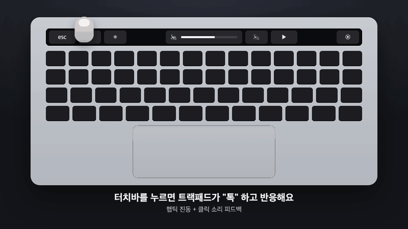
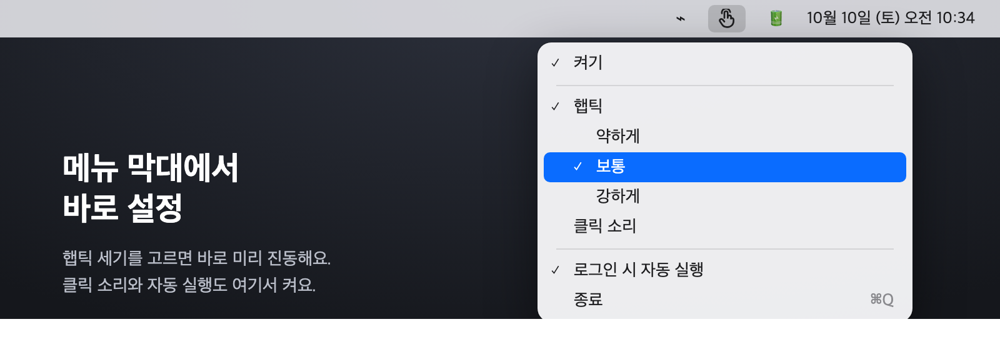

# TouchBarFeedback

**한국어** | [English](README.en.md)

<p align="center"></p>

맥북 터치바를 누를 때 **트랙패드 햅틱 진동**이나 **클릭 소리**로 피드백을 주는 메뉴 막대 앱입니다.

터치바에는 진동 모터가 없어서 누른 느낌이 거의 없죠. 이 앱은 터치바 터치를 감지해서 바로 아래 트랙패드의 햅틱 엔진(Force Touch)을 울려줍니다. 키보드에 손을 올린 채로 손바닥에서 "톡" 하는 감각이 느껴집니다.

## 기능

- 터치바 어디를 누르든(Esc, 볼륨 슬라이더, 앱 버튼 등) 터치가 시작될 때 피드백
- 햅틱 세기 3단계: 약하게 / 보통 / 강하게
- 클릭 소리(시스템 Tink) 켜기/끄기
- 로그인 시 자동 실행
- 설정은 자동 저장, 별도 창 없이 메뉴 막대 아이콘으로만 동작

## 요구 사항

- 터치바가 있는 맥북 프로
- macOS 13 Ventura 이상 (macOS 15.5, Apple Silicon에서 테스트)
- Xcode 또는 Command Line Tools (`xcode-select --install`)

## 설치

```bash
git clone https://github.com/suinegyzal/TouchBarFeedback.git
cd TouchBarFeedback
./build.sh
open ~/Applications/TouchBarFeedback.app
```

`build.sh`가 소스를 컴파일해서 `~/Applications/TouchBarFeedback.app`에 설치합니다.

### 처음 실행할 때

1. **입력 모니터링 권한**을 허용해 주세요.
   시스템 설정 → 개인정보 보호 및 보안 → 입력 모니터링 → TouchBarFeedback 켜기
   (메뉴 아이콘의 "⚠️ 입력 모니터링 권한 필요"를 누르면 바로 열립니다)
2. 권한을 켜면 몇 초 안에 자동으로 인식됩니다. 터치바를 눌러보세요.

> 다시 빌드하면 코드 서명이 바뀌어서 권한을 한 번 더 허용해야 할 수 있습니다.

## 사용법

메뉴 막대의 👆 아이콘을 누르면 설정할 수 있습니다. 메뉴는 시스템 언어에 따라 한국어 또는 영어로 표시됩니다.

<p align="center"></p>

| 메뉴 | 설명 |
|---|---|
| 켜기 | 피드백 전체 켜기/끄기 |
| 햅틱 / 세기 | 트랙패드 진동과 세기 (세기를 고르면 바로 미리 진동) |
| 클릭 소리 | 누를 때 클릭 소리 재생 |
| 로그인 시 자동 실행 | 재부팅 후에도 자동 실행 |

## 동작 원리

1. **터치 감지**: `CGEventTap`(읽기 전용)으로 제스처 이벤트를 받고, 그중 `NSTouch.type == .direct`인 터치만 골라냅니다. 터치바 터치는 direct, 트랙패드 터치는 indirect라서 구분됩니다. 다른 앱의 이벤트를 막거나 바꾸지 않습니다.
2. **햅틱**: 손가락이 트랙패드에 없어도 진동하도록 비공개 프레임워크 `MultitouchSupport`의 `MTActuator*` 함수로 트랙패드 액추에이터를 직접 구동합니다.
3. **소리**: 지연을 줄이려고 시스템 사운드를 미리 로드해 두고 재생합니다.

## 알려진 제한

- 햅틱은 애플의 **비공개 API**를 쓰기 때문에 macOS 업데이트 후 동작하지 않을 수 있습니다. 그래서 App Store에는 올릴 수 없습니다.
- 진동은 터치바가 아니라 트랙패드에서 느껴집니다.

## 제거

메뉴에서 "로그인 시 자동 실행"을 끄고 종료한 뒤 앱을 지웁니다.

```bash
rm -rf ~/Applications/TouchBarFeedback.app
```

## 참고

같은 아이디어를 먼저 구현한 오픈소스 프로젝트 [HapticKey](https://github.com/niw/HapticKey)를 참고했습니다.

## 라이선스

MIT
